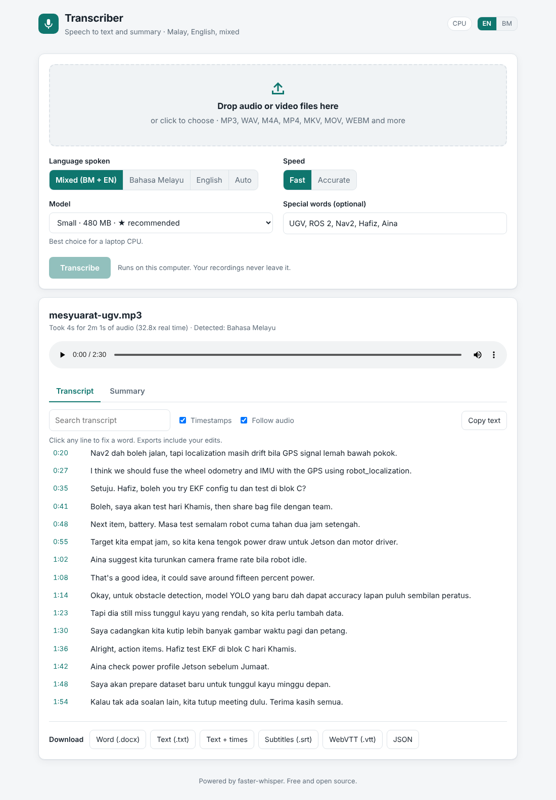
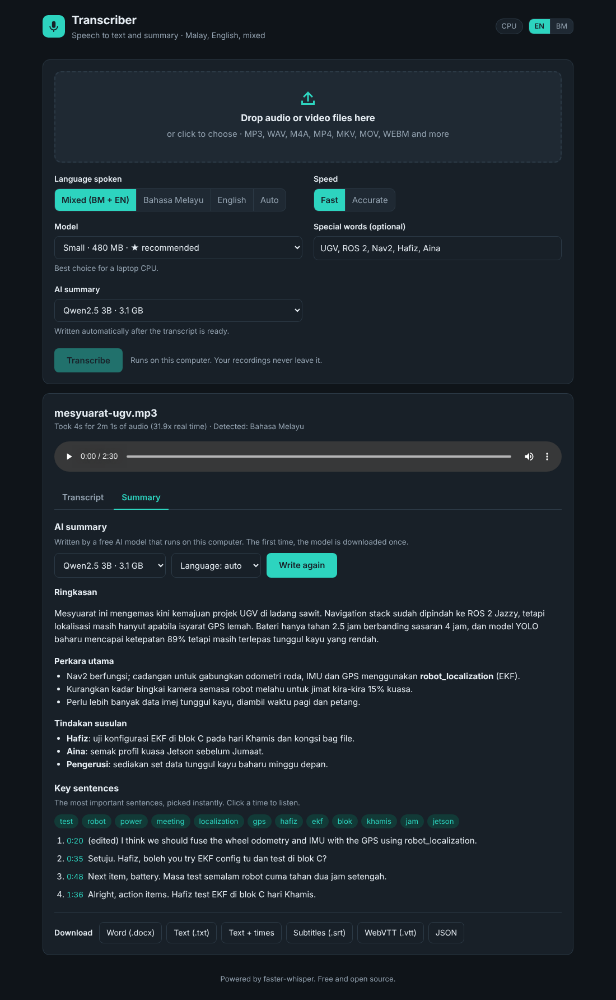
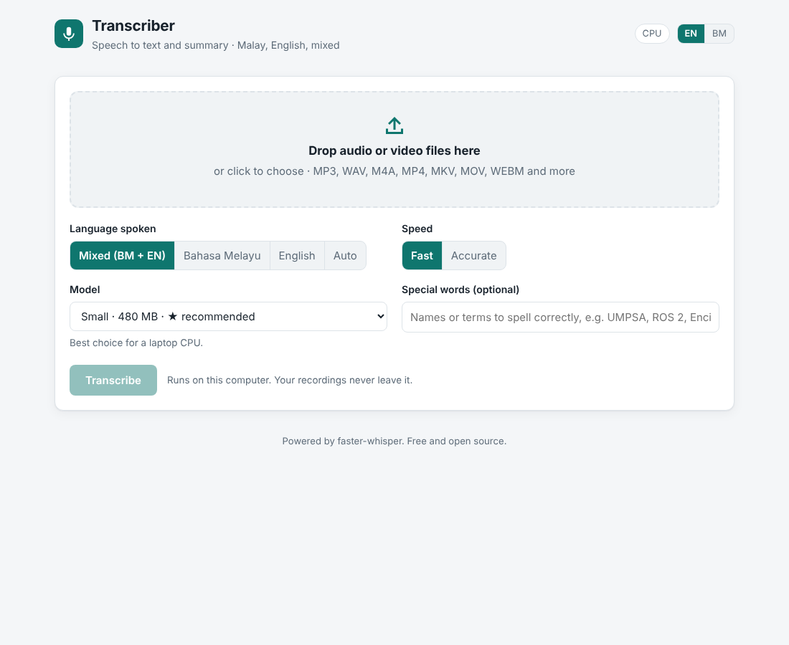

# Transcriber

A local speech-to-text and summary tool for **Bahasa Melayu, English, and mixed Malay-English** recordings. Drop in an audio or video file (a meeting, lecture, interview or voice note) and get a timestamped transcript, a summary, and Word, subtitle or text files to download.

It runs on your own computer with free, open models ([faster-whisper](https://github.com/SYSTRAN/faster-whisper)). There's no account, no API key and no upload: recordings never leave the machine, and after the first model download it works offline.



## Features

- **Any audio or video format**: MP3, WAV, M4A, AAC, OGG, OPUS, FLAC, WMA, MP4, MKV, MOV, WEBM, AVI and more. Videos are fine; only the sound is used.
- **Malay, English or mixed.** In *Mixed* mode the language is detected per segment, so a sentence like "So lepas meeting, kita proceed dengan plan baru" keeps its English words in English.
- **Choose the model**, from *Tiny* (fastest) to *Large v3* (most accurate), plus a **Malaysian Turbo** model fine-tuned on Malaysian speech and Manglish. The app recommends one for your hardware and marks the models you have already downloaded.
- **Fast by default**: voice activity detection skips silence, and the batched pipeline decodes several chunks in parallel. Switch to *Accurate* for beam search when quality matters more than speed.
- **Live transcript**: text appears while it is still being transcribed, with a progress bar and time left.
- **Click a timestamp to play from there**, and the player highlights the line being spoken. You can search the transcript and edit any line to fix a word; downloads include your edits.
- **Special words**: type names or terms such as "UMPSA, ROS 2, Encik Hafiz" so they are spelled correctly.
- **AI summary out of the box**: as soon as the transcript is ready, a built-in AI model (Qwen2.5, free, runs on your computer) writes a summary with key points and action items, in Bahasa Melayu or English. You watch it being written, and you can rewrite it with another model or language. No Ollama or API key is needed.
- **Key sentences**: the most important sentences and keywords, picked instantly. Click a time to listen.
- **Downloads**: Word (.docx, with the summary), plain text, text with timestamps, SRT and WebVTT subtitles, and JSON.
- **Several files at once**: queue as many as you like and switch between them.
- English or Bahasa Melayu interface, light and dark mode, works on a phone.
- A **command-line** version for batch jobs and headless machines.



## Quick start (Ubuntu 24.04)

```bash
sudo apt install -y python3-venv git          # ffmpeg is optional
git clone https://github.com/MuhamadMursyied/transcriber-generator.git
cd transcriber-generator
./run.sh
```

`run.sh` creates a virtual environment on the first run, installs the two dependencies (`faster-whisper` and `flask`), adds the CUDA libraries if it finds an NVIDIA GPU, and opens http://127.0.0.1:7860 in your browser.

The first time you use a model, it is downloaded once (75 MB to 3 GB) into `~/.cache/huggingface`. After that, everything works offline.

To use it from your phone or another PC on the same network (handy on a headless NUC or Jetson):

```bash
./run.sh --host 0.0.0.0 --no-browser
# then open http://<machine-ip>:7860
```

Manual setup, if you prefer:

```bash
python3 -m venv .venv
source .venv/bin/activate
pip install -r requirements.txt
python app.py
```



## Choosing a model

| Model | Download | Good for |
|---|---|---|
| Tiny | 75 MB | Fastest, rough. Quick checks. |
| Base | 145 MB | Very fast. Clear English. |
| **Small** | 480 MB | **Default on CPU.** Good balance on a laptop or NUC. |
| Medium | 1.5 GB | Better Malay, but slow on CPU. |
| **Large v3 Turbo** | 1.6 GB | **Default on GPU.** Near Large v3 accuracy at several times the speed. |
| Large v3 | 3.1 GB | Most accurate general model, slowest. |
| Malaysian Turbo | 1.6 GB | Large v3 Turbo fine-tuned on Malaysian speech. Best for local accents and Manglish. |

Rules of thumb:

- **CPU only**: start with *Small* + *Fast*. Use *Medium* if Malay accuracy isn't good enough and you can wait.
- **NVIDIA GPU**: *Large v3 Turbo* or *Malaysian Turbo*. Both are fast enough for hour-long recordings.
- **Heavy Malaysian accent or lots of code-switching**: *Malaysian Turbo*.

*Malaysian Turbo* is a CTranslate2 conversion of [mesolitica/Malaysian-whisper-large-v3-turbo-v3](https://huggingface.co/mesolitica/Malaysian-whisper-large-v3-turbo-v3) published by the community. If you'd rather convert the original yourself, run `./scripts/convert_malaysian.sh`; the result appears in the model list as *(local)*. The same script converts the smaller mesolitica models too:

```bash
./scripts/convert_malaysian.sh mesolitica/malaysian-whisper-small-v3 malaysian-small
```

## Languages

| Option | What it does |
|---|---|
| Mixed (BM + EN) | Detects the language for each segment and adds a short code-switching example as context, so neither language gets translated into the other. With *Malaysian Turbo* it uses that model's own Malay token, which was trained on mixed speech. |
| Bahasa Melayu | Forces Malay. Best for formal Malay (news, ceramah, lectures). |
| English | Forces English. |
| Auto | Detects one language from the first 30 seconds. |

## AI summary

The summary is written by a small instruction-tuned model, run with CTranslate2 (the same engine faster-whisper uses), so no extra packages are needed. Pick it under **AI summary** before you transcribe, or later on the Summary tab.

| Model | Download | Notes |
|---|---|---|
| **Qwen2.5 3B** | 3.1 GB | Default. Follows Malay or English reliably and picks up action items. Needs about 4 GB of free RAM. On a laptop CPU (i7-1265U) a meeting summary takes about 1 to 1.5 minutes. |
| Qwen2.5 1.5B | 1.5 GB | About twice as fast, but only a rough draft: it can miss tasks or slip into English. |

The model downloads once on first use, then it works offline. The summary language follows the recording (Malay or mixed gives Malay, English gives English), or you can choose one. Long recordings are read in parts first, then the notes are combined, so any length works.

Already run [Ollama](https://ollama.com)? Its models show up in the same list (for example `qwen2.5:7b` for even better summaries).

## Command line

```bash
source .venv/bin/activate
python cli.py meeting.mp4                                  # writes meeting.txt, .srt, .docx
python cli.py ceramah.m4a --model medium --language ms --format txt,docx
python cli.py meeting.mp4 --summary                        # + AI summary in the .docx
python cli.py recordings/*.mp3 --out transcripts/ --summary qwen2.5-1.5b
python cli.py --help
```

## NUC, Jetson and GPUs

- **Intel NUC / any x86 CPU**: works out of the box with int8 inference. Use *Small* or *Base*.
- **NVIDIA desktop or laptop GPU**: `run.sh` installs the CUDA 12 cuBLAS and cuDNN 9 libraries from pip, so you don't need a system CUDA install. Only the NVIDIA driver is needed. The device badge in the top bar shows **GPU (CUDA)** when it is active.
- **Jetson (aarch64)**: the CTranslate2 wheel on PyPI is CPU-only for ARM, so out of the box the app runs on the Jetson's CPU (use *Base* or *Small*). For GPU speed, build [CTranslate2 from source](https://opennmt.net/CTranslate2/installation.html#install-from-sources) with `-DWITH_CUDA=ON` inside the venv.

## How it works

```
browser (static/)                Flask (app.py)                 worker thread (stt/jobs.py)
 upload file + options  ──POST──▶ save to temp file  ──queue──▶  decode audio with PyAV (any format, 16 kHz mono)
 poll every second      ◀──GET─── job state + new segments       load model once, keep it cached
 click time → seek player                                         faster-whisper: VAD + batched decoding
 edit line  ──PUT──▶ update segments                              segments streamed into the job
 download   ──GET──▶ stt/export.py (TXT/SRT/VTT/JSON/DOCX)        quick summary when done
 AI summary ──POST─▶ stt/summary.py ──▶ stt/llm.py (Qwen2.5 on CTranslate2) or Ollama
```

Design choices:

- **faster-whisper** (CTranslate2) is up to 4x faster than the original Whisper with the same accuracy and less memory, and it runs int8 on any CPU. It also bundles PyAV, so no system ffmpeg is needed. The `ffmpeg` command is only used as a fallback for rare files.
- **One worker, one cached model.** Whisper already uses every core or the whole GPU, so files are processed one after another, and the last model stays in memory so the next file starts at once.
- **Two Python dependencies.** The web server is Flask, the UI is plain HTML/CSS/JS with no build step, the summary model reuses CTranslate2 and `tokenizers` from faster-whisper, and the .docx is written directly with `zipfile`.
- The uploaded copy is deleted as soon as transcription finishes. The browser plays your original file locally.

## Project layout

```
app.py              web server and API
cli.py              command-line version
run.sh              one-command setup and start
stt/
  models.py         model list, GPU detection, model cache
  engine.py         audio decoding, language options, transcription
  jobs.py           background job queue
  summary.py        key sentences and AI summary prompts (map-reduce)
  llm.py            built-in summary model (Qwen2.5 on CTranslate2)
  export.py         TXT, SRT, VTT, JSON and DOCX writers
static/             index.html, style.css, app.js
scripts/            convert_malaysian.sh
tests/              unit and API tests (no model download needed)
```

## Tests

```bash
source .venv/bin/activate
python -m unittest -v
```

The API tests swap in a fake speech engine, so they run in under a second without downloading a model.

## Troubleshooting

- **"Loading model" takes a long time**: the first use of each model downloads it. Watch the terminal for progress.
- **Out of memory**: choose a smaller model. Large models need about 4 GB of RAM on CPU or 3 GB of VRAM with float16.
- **`libcublas.so.12` / `libcudnn` not found**: start with `./run.sh`, which sets `LD_LIBRARY_PATH` for the pip-installed CUDA libraries.
- **English words come out in Malay (or the other way round)**: use *Mixed*, or try *Malaysian Turbo*.
- **Wrong spelling of names**: add them to *Special words*.

## License and credits

MIT. See [LICENSE](LICENSE).

Built on [faster-whisper](https://github.com/SYSTRAN/faster-whisper) and OpenAI's [Whisper](https://github.com/openai/whisper) models, with Malaysian models by [Mesolitica](https://huggingface.co/mesolitica) and summaries by [Qwen2.5](https://huggingface.co/Qwen) (CTranslate2 conversions by jncraton).
